# BI Data Warehouse UTS Execution Plan (24 to 25 Nov 2026)

Owner: Sebastian (ULM, Teknologi Informasi, Big Data)
Course: Kecerdasan Bisnis (BI), individual Data Warehouse UTS
Case (locked): Wasaka Interactive, Indie Studio Multi-Revenue Analytics
Plan written: 23 Nov 2026
Target: working app and report ready by the end of 25 Nov 2026

Read Section 0 (Guardrails) and Section 1 (Locked Decisions) before changing files. If a requirement is unclear, ask Sebastian instead of guessing.

## Overview

```mermaid
flowchart LR
    subgraph D24["Tue 24 Nov"]
        A["Phase 1: Repo + env setup"] --> B["Phase 2: Synthetic raw sources + real FX"]
        B --> C["Phase 3: DuckDB DDL + ETL"]
        C --> D["Phase 4: Validation suite"]
        D --> E["Phase 5: Streamlit no-code OLAP app"]
    end
    subgraph D25["Wed 25 Nov"]
        F["Phase 6: Diagrams + screenshots"] --> G["Phase 7: Fill BI-Design report"]
        G --> H["Phase 8: Demo script + reviewer Q&A prep"]
    end
    E --> F
    H --> I["Present when lecturer assigns slot + record video"]
    I --> J["Post-review conclusion"]
    J --> K["Upload 4 deliverables to e-learning"]
```



### Fixed class schedule

| Day | Class | Time (WITA) |
|---|---|---|
| Tue 24 Nov | DATA ANALITIK (Lab Big Data) | 13:00-15:30 |
| Wed 25 Nov | KECERDASAN BISNIS (A.14) | 08:00-10:30 |
| Wed 25 Nov | METODOLOGI PENELITIAN (A.14) | 10:30-12:10 |

Gimersia Inspire 2026 (Canting Cloth) is due 30 Nov 2026 at 00:59 WITA. BI build and report work stops at the end of 25 Nov. From 26 Nov onward, only presenting, recording, and writing the post-review conclusion remain on the lecturer's schedule. Stop work around 23:30 both nights.

## 0. Guardrails

1. Keep the 6-table star schema in Section 2 unchanged. Do not add, remove, or rename columns or tables in `edw`.
2. Do not reopen the business case, tech stack, or atomic event grain.
3. No ML, forecasting, or Data Analytics operations (roll-up, drill-down, dice, pivot). Label the UI as a query interface.
4. Leave the original `BI-Design-Template.docx` untouched. Edit only the copy under `report/`.
5. Environment is Windows PowerShell with Python 3.10+ inside a local `.venv`.
6. Disclose clearly in the README and report that transaction records are synthetic while FX rates are real ECB data.
7. Keep fee rates in `config.py` with their sources documented.
8. Raw exports include buyer usernames and emails; staging drops them so no PII enters `edw` or `mart`.
9. Report language is Bahasa Indonesia matching the existing draft; code identifiers are English.

## 1. Locked decisions

| Topic | Decision |
|---|---|
| Stack | DuckDB (single file DW and OLAP engine), Python/pandas (ETL and generation), Streamlit + Plotly (front end). |
| Architecture | Kimball star schema with logical schemas `stg`, `edw`, and `mart` inside one DuckDB file (`INT_DB` folded into transform logic and views, matching Limitation #4). |
| Grain | One row per financial event: `SALE`, `TIP`, `REFUND`, `PLATFORM_FEE`, `PROCESSING_FEE`, `FEE_REVERSAL`. |
| `FEE_REVERSAL` | Kept. Models the asymmetry where storefronts reverse platform cuts on refund while payment processors keep processing fees. |
| Stripe | Removed from the report copy (not in the platform list; processing fees come from PayPal, VGen, and itch.io checkout). |
| Partial refunds | Allowed for commissions. Total refunds per `parent_transaction_code` must stay at or below the parent sale amount. |
| Signs | Positive: `SALE`, `TIP`, `FEE_REVERSAL`. Negative: `REFUND`, `PLATFORM_FEE`, `PROCESSING_FEE`. Net revenue equals `SUM(amount_idr)`. |
| Identifiers | `transaction_code` is `<<DD>>` and unique per event. `parent_transaction_code` is a lineage key (intentionally not `<<DD>>`), NULL on root sales. |
| Currencies | IDR, USD, SGD, JPY, CNY, EUR, GBP converted to IDR using the event-date spot rate. |
| Stream and platform pairs | `GAME_SALES`: STEAM, ITCH. `ASSET_SALES`: ITCH, VGEN. `COMMISSION`: VGEN, FIVERR, PAYPAL (PayPal modeled as direct-commission platform). |
| Repo | `d:\Downloads\random\bi-dw-uts\` |
| Load strategy | Idempotent full refresh per run. Incremental loads noted as future work. |
| Peer review | Lecturer assigns two reviewers (1 business, 1 technical). Presentation date is unconfirmed; be ready from 25 Nov. |

## 2. Approved schema (`edw`)

```
dim_date(date_key INT PK, full_date DATE NK, day_of_week VARCHAR(20), day_of_week_number INT,
         day_of_month INT, day_of_year INT, month_name VARCHAR(20), month_number INT,
         quarter INT, year INT, is_weekend BOOLEAN)
dim_revenue_stream(revenue_stream_key INT PK, revenue_stream_code VARCHAR(50) NK,
                   revenue_stream_name VARCHAR(100), description VARCHAR(255))
dim_currency(currency_key INT PK, currency_code CHAR(3) NK, currency_name VARCHAR(50), currency_symbol VARCHAR(5))
dim_platform(platform_key INT PK, platform_code VARCHAR(50) NK, platform_name VARCHAR(100), platform_type VARCHAR(50))
dim_project(project_key INT PK, project_code VARCHAR(50) NK, project_name VARCHAR(150),
            project_type VARCHAR(50), production_field VARCHAR(100))
fact_revenue_event(revenue_event_sk BIGINT PK,
                   date_key INT FK, project_key INT FK, platform_key INT FK,
                   currency_key INT FK, revenue_stream_key INT FK,
                   transaction_code VARCHAR(100) DD, parent_transaction_code VARCHAR(100),
                   event_type VARCHAR(30), amount_orig DECIMAL(18,2),
                   exchange_rate_to_idr DECIMAL(18,6), amount_idr DECIMAL(18,2))
```

DDL constraints: primary keys, five foreign keys, `UNIQUE(transaction_code)`, `event_type` check, sign check on `amount_orig` and `amount_idr`, and `exchange_rate_to_idr > 0`. `dim_date` spans `2025-01-01` through `2026-12-31` with `YYYYMMDD` keys.

## 3. Target repository layout

```
bi-dw-uts/
├── PLAN.md
├── README.md
├── IMPLEMENTATION_LOG.md
├── requirements.txt
├── config.py
├── data/
│   ├── raw/
│   └── warehouse.duckdb
├── sql/
│   ├── 00_schemas.sql
│   ├── 01_ddl_edw.sql
│   ├── 02_mart_views.sql
│   └── 03_validate.sql
├── src/
│   ├── generate_sources.py
│   ├── fetch_fx.py
│   ├── etl.py
│   └── validate.py
├── app/
│   ├── app.py
│   └── query_builder.py
├── diagrams/
└── report/
    ├── findings_raw.md
    ├── sections_id.md
    └── screenshots/
```

## 4. Tuesday 24 Nov: Build phases (Done)

- Phase 1: create directory layout, `.venv`, install dependencies, initialize Git.
- Phase 2: author `projects.csv` (from Sebastian's real portfolio) and `project_title_map.csv`, generate 5 raw exports in different formats (`steam_sales_report.csv`, `itch_payouts.csv`, `vgen_export.json`, `fiverr_earnings.csv`, `paypal_activity.csv`), and fetch real ECB daily rates via Frankfurter API into `fx_rates.csv`.
- Phase 3: load raw files into `stg`, drop PII, deduplicate Fiverr re-exports, map titles and quarantine unmatched rows in `stg.etl_rejects`, expand events with sign rules and prior-business-day FX fallback, load `edw`, and build `edw.v_fact_enriched` + 4 `mart` views.
- Phase 4: run `sql/03_validate.sql` through `src/validate.py` verifying V1 through V14.
- Phase 5: build the 3-tab Streamlit app (whitelisted no-code query builder with currency-group guard and SQL expander, 4 business-question presets, architecture and live validation tab), write `README.md`, `report/findings_raw.md`, and `IMPLEMENTATION_LOG.md`, and commit.

## 5. Views reference

- `edw.v_fact_enriched`: wide star join of `fact_revenue_event` to all 5 dimension tables.
- `mart.v_revenue_monthly`: monthly gross, tips, fees, refunds, reversals, net, and event count by stream, platform, and currency.
- `mart.v_project_performance`: gross, net, leakage amount, and leakage % per project and production field.
- `mart.v_fee_refund_leakage`: gross, platform fees, processing fees, refunds, reversals, net, and leakage % per platform and stream.
- `mart.v_fx_exposure`: monthly original-currency totals, net IDR, rate min/avg/max, and currency shares.

## 6. Wednesday 25 Nov: Report and presentation prep (Done)

### Phase 6: Diagrams and screenshots (Done)
Rendered 5 PlantUML diagrams (`01_etl_flow`, `02_vgen_json_schema`, `03_data_tunnel`, `04_dw_architecture`, `05_storage_design`) plus `06_star_schema_edw.png`, and captured 6 live Streamlit screenshots plus `07_cli_etl_validate.png` into `report/screenshots/`.

### Phase 7: Complete report copy (Done)
Drafted `report/sections_id.md` and generated `report/UTS_BI_Sebastian_Wasaka_DW.docx` from a clean copy of `BI-Design-Template.docx` (original untouched), resolving all placeholders, typos, example images, governance matrix, budget, query results, findings, and V1 to V14 validation summary.

### Phase 8: Presentation prep (Done)
Prepared `report/demo_script.md` (15 to 20 minute live walkthrough) and `report/qa_prep.md` (7 Business and 10 Technical reviewer Q&A answers). Ready for lecturer-assigned presentation slot.

## 7. After presenting

1. Record the presentation and peer-review Q&A (check audio and storage beforehand).
2. Collect the two peer-review assessments (exact format TBA).
3. Write `Kesimpulan setelah peer-review` summarizing reviewer challenges, responses, and follow-up changes.
4. Upload all four deliverables to e-learning and mark the Notion task Done.

## 8. Data governance matrix (for report section 3.2)

| Data domain | Data Owner | Data Steward | Data Provider / source | Custodian | Consumers | Notes |
|---|---|---|---|---|---|---|
| Steam game sales, refunds, fees | Studio Lead | Finance & Admin | Valve (Steamworks export) | IT & Data Eng | Studio Lead, Finance | Studio owns its sales records; Valve is provider |
| itch.io game & asset payouts | Studio Lead | Finance & Admin | itch.io export | IT & Data Eng | Studio Lead, Finance, Production | `buyer_email` dropped at staging |
| VGen assets, commissions, tips, refunds | Studio Lead | Commission & Client Relations (+ Finance) | VGen JSON export | IT & Data Eng | Commission, Finance | `client_username` dropped |
| Fiverr commissions & tips | Studio Lead | Commission & Client Relations | Fiverr earnings export | IT & Data Eng | Commission, Finance | `buyer_username` dropped; duplicates removed |
| PayPal direct commissions, tips, fees | Studio Lead | Finance & Admin | PayPal activity export | IT & Data Eng | Finance | Modeled as direct-commission platform; payer PII dropped |
| Historical FX spot rates | Finance & Admin | IT & Data Eng | ECB via Frankfurter API | IT & Data Eng | Finance, Studio Lead | Prior business day fallback for weekends/holidays |
| Project registry & production fields | Production Division | Production Division | Internal `projects.csv` | IT & Data Eng | All | Canonical project codes |
| Commission title mapping | Commission & Client Relations | Commission & Client Relations | Internal `project_title_map.csv` | IT & Data Eng | ETL | Unmatched titles quarantined in `stg.etl_rejects` |
| Revenue taxonomy & sign rules | Finance & Admin | Finance & Admin | Internal accounting rules | IT & Data Eng | All | Defines event types and signs |
| DW (`stg`/`edw`/`mart`) & app | Studio Lead | IT & Data Eng | Internal | IT & Data Eng | All divisions | Local single-user deployment; RBAC is future work |

PII policy: personal identifiers from platform exports stay inside transient `stg` tables and never enter `edw` or `mart` (verified by V13).

## 9. Risks and fallbacks

- If Frankfurter API is unreachable on a future run, `src/fetch_fx.py` falls back to seeded simulated FX and logs the mode in `fx_metadata.json`.
- If PlantUML rendering is unavailable, draw diagrams in Mermaid or draw.io.
- If the presentation slot arrives before the report is finalized, demo directly from the working Streamlit app and finish the report afterward.
- Defer new features (extra dimensions, SCD Type 2, incremental ETL, auth, expense/profit marts) to future work.

## 10. Open items (updated 24 Nov 2026)

1. Resolved: VGen fee verified at 5.0% (+ 2.9% + $0.30 processing); PayPal Indonesia verified at 3.40% domestic / 4.40% cross-border + fixed fee.
2. Resolved: `projects.csv` populated with Sebastian's portfolio projects across all 6 production fields.
3. TBA: confirm what "Dua penilaian peer-review" refers to.
4. TBA: exact e-learning upload cutoff.
