# BI Data Warehouse UTS — Execution Plan (24–25 Nov 2026)

**Owner:** Sebastian (ULM, Teknologi Informasi, Big Data)
**Course:** Kecerdasan Bisnis (BI): UTS individual Data Warehouse project
**Case (locked):** *Wasaka Interactive*, Indie Studio Multi-Revenue Analytics
**Plan written:** 23 Nov 2026, 19:30 WITA
**Target:** the working app and report are presentation-ready by the end of **25 Nov 2026**

> This plan is written for another AI model or collaborator to execute. Read **Section 0 (Guardrails)** and **Section 1 (Locked Decisions)** before touching anything. When something is ambiguous, ask Sebastian. Don't guess.

---

## Overview

```mermaid
flowchart LR
    subgraph D24["Tue 24 Nov"]
        A["Phase 1: Repo + env setup"] --> B["Phase 2: Synthetic raw sources + real FX"]
        B --> C["Phase 3: DuckDB DDL + ETL"]
        C --> D["Phase 4: Validation suite"]
        D --> E["Phase 5: Streamlit no-code OLAP app"]
    end
    subgraph D25["Wed 25 Nov"]
        F["Phase 6: Diagrams + screenshots"] --> G["Phase 7: Fill BI-Design report"]
        G --> H["Phase 8: Demo script + reviewer Q&A prep"]
    end
    E --> F
    H --> I["Present when lecturer assigns slot + record video"]
    I --> J["Post-review conclusion"]
    J --> K["Upload 4 deliverables to e-learning"]
```



### Fixed calendar constraints (classes, not movable)
| Day | Class | Time (WITA) |
|---|---|---|
| Tue 24 Nov | DATA ANALITIK (Lab Big Data) | 13:00–15:30 |
| Wed 25 Nov | KECERDASAN BISNIS (A.14) | 08:00–10:30 |
| Wed 25 Nov | METODOLOGI PENELITIAN (A.14) | 10:30–12:10 |

**Gimersia Inspire 2026 (Canting Cloth)** is due **30 Nov 2026, 00:59 WITA**. BI work has a **hard stop at the end of 25 Nov**. From 26 Nov the only BI work left is presenting, recording, and writing the post-review conclusion, all on the lecturer's schedule.

**Sleep guardrail:** stop work by ~23:30 both nights. A tired demo is worse than a slightly smaller app.

---

## 0. Guardrails for the executor

1. **Do NOT redesign the schema.** The 6-table star schema in Section 2 is approved. Don't add, remove or rename columns or tables in `edw`.
2. **Do NOT reopen the case**, the stack, or the event-level grain.
3. **No ML, no forecasting, no "advanced analytics."** The lecturer put roll-up, drill-down, dice and pivot under the *Data Analytics* course. The app is a **query interface** over the DW. Don't label features with those terms.
4. **Never modify the original `BI-Design-Template.docx`.** Work on a copy (Section 7).
5. **Environment:** Windows, PowerShell (no bash-isms), Python 3.10+. Use a venv inside the repo.
6. **Be honest about synthetic data.** The report must state clearly that transaction data is synthetic, generated from documented assumptions. FX rates are real (Frankfurter/ECB) if the fetch works.
7. **Fee percentages:** keep them in `config.py` with a `source`/`verify` note. Don't state a fee rate as a fact in the report unless it has been checked against the platform's current published terms. Mark unverified ones for Sebastian.
8. **No personal data in the DW.** Raw exports deliberately include buyer usernames and emails. Staging drops them (governance demo).
9. **Report language:** Bahasa Indonesia, matching the existing document. Code and comments: English.
10. Keep comments in the code minimal and meaningful.

---

## 1. Locked decisions (do not revisit)

| Topic | Decision |
|---|---|
| Stack | **DuckDB** (single file DW + OLAP engine) + **Python/pandas** (ETL + data generation) + **Streamlit** (front end). Plotly or Streamlit-native charts. |
| Architecture | Kimball star schema. Logical layers inside **one DuckDB file**: `stg` (raw, as-is) → `edw` (star schema) → `mart` (views). The template's `INT_DB` layer is folded into transform logic and views (already justified by Limitation #4 in the docx). |
| Grain | **One row = one financial event**: SALE, TIP, REFUND, PLATFORM_FEE, PROCESSING_FEE, FEE_REVERSAL. Never daily aggregates. |
| `FEE_REVERSAL` | **Keep.** It's already in the docx (Introduction). It models the key asymmetry: on a refund the storefront returns its platform cut (`FEE_REVERSAL`, +) but the payment processor keeps its processing fee. This is exactly the "Net Revenue Blindness" problem in the Background section. |
| Stripe | **Remove** from the docx (lines mentioning Stripe in Introduction and Definitions). It isn't modelled; processing fees come from PayPal and itch.io's checkout. |
| Partial refunds | **Allowed** (commissions can be partly refunded per milestone). Rule: total refunds per parent ≤ the parent sale amount. |
| Signs | Positive: SALE, TIP, FEE_REVERSAL. Negative: REFUND, PLATFORM_FEE, PROCESSING_FEE. Net revenue = `SUM(amount_idr)`. |
| Identifiers | `transaction_code` = `<<DD>>`, unique per event. `parent_transaction_code` = lineage key (**not** `<<DD>>`, intentionally), linking fees, refunds, reversals and tips to the root SALE. NULL on a root SALE. |
| Currencies | IDR, USD, SGD, JPY, CNY, EUR, GBP → IDR via the per-event spot rate. |
| Stream × platform | GAME_SALES: STEAM, ITCH · ASSET_SALES: ITCH, VGEN · COMMISSION: VGEN, FIVERR, PAYPAL. PayPal is a **direct-commission platform**, not just a processor. |
| Repo | `d:\Downloads\random\bi-dw-uts\` |
| Load strategy | Full refresh (drop & rebuild) per run, which keeps it idempotent. Incremental loading = future work. |
| Peer review | The lecturer assigns reviewers (1 business, 1 technical). Sebastian doesn't pick. The presentation date is **not confirmed**; be ready from 25 Nov. |

---

## 2. Approved schema (from the docx PlantUML, do not change)

```
dim_date(date_key INT PK, full_date DATE NK, day_of_week VARCHAR(20), day_of_week_number INT,
         day_of_month INT, day_of_year INT, month_name VARCHAR(20), month_number INT,
         quarter INT, year INT, is_weekend BOOLEAN)
dim_revenue_stream(revenue_stream_key INT PK, revenue_stream_code VARCHAR(50) NK,
                   revenue_stream_name VARCHAR(100), description VARCHAR(255))
dim_currency(currency_key INT PK, currency_code CHAR(3) NK, currency_name VARCHAR(50), currency_symbol VARCHAR(5))
dim_platform(platform_key INT PK, platform_code VARCHAR(50) NK, platform_name VARCHAR(100), platform_type VARCHAR(50))
dim_project(project_key INT PK, project_code VARCHAR(50) NK, project_name VARCHAR(150),
            project_type VARCHAR(50), production_field VARCHAR(100))
fact_revenue_event(revenue_event_sk BIGINT PK,
                   date_key, project_key, platform_key, currency_key, revenue_stream_key  -- all INT FK NOT NULL
                   transaction_code VARCHAR(100) DD, parent_transaction_code VARCHAR(100),
                   event_type VARCHAR(30), amount_orig DECIMAL(18,2),
                   exchange_rate_to_idr DECIMAL(18,6), amount_idr DECIMAL(18,2))
```

**Constraints to add in DDL** (these add integrity, not columns, so they're allowed):
- PKs and FKs as above. DuckDB enforces FKs, so insert dims before facts and drop the fact table first on rebuild.
- `UNIQUE(transaction_code)`.
- `CHECK (event_type IN ('SALE','TIP','REFUND','PLATFORM_FEE','PROCESSING_FEE','FEE_REVERSAL'))`.
- Sign check:
  `CHECK ((event_type IN ('SALE','TIP','FEE_REVERSAL') AND amount_orig > 0 AND amount_idr > 0) OR (event_type IN ('REFUND','PLATFORM_FEE','PROCESSING_FEE') AND amount_orig < 0 AND amount_idr < 0))`
- `CHECK (exchange_rate_to_idr > 0)`.
- `date_key` format `YYYYMMDD`. `dim_date` covers **2025-01-01 → 2026-12-31**.
- Surrogate keys: DuckDB sequences, or assigned in pandas (either is fine; be consistent).

---

## 3. Repo layout (target)

```
bi-dw-uts/
├── PLAN.md                  # this file
├── README.md                # how to run, architecture summary, synthetic-data disclosure
├── requirements.txt         # duckdb, pandas, streamlit, plotly, requests
├── config.py                # date window, fee rates (with source/verify notes), seeds, paths
├── data/
│   ├── raw/                 # generated "platform exports" + fx_rates.csv + internal master files
│   └── warehouse.duckdb     # built output (gitignored)
├── sql/
│   ├── 00_schemas.sql       # CREATE SCHEMA stg, edw, mart
│   ├── 01_ddl_edw.sql       # 6 tables + constraints
│   ├── 02_mart_views.sql    # mart views (Section 5.3)
│   └── 03_validate.sql      # validation queries (Section 6)
├── src/
│   ├── generate_sources.py  # Phase 2
│   ├── fetch_fx.py          # Phase 2 (Frankfurter, cached)
│   ├── etl.py               # Phase 3 (extract → transform → load)
│   └── validate.py          # runs 03_validate.sql, prints PASS/FAIL table, non-zero exit on FAIL
├── app/
│   ├── app.py               # Streamlit entry
│   └── query_builder.py     # whitelisted SQL generation
├── diagrams/                # .puml sources + rendered .png
└── report/
    ├── sections_id.md       # ready-to-paste Indonesian text per docx section
    └── screenshots/
```

---

## 4. TUESDAY 24 NOV: Build day

### Phase 1: Setup (09:00–09:30)
- Create the folders above, `python -m venv .venv`, install requirements, `git init`, `.gitignore` (`.venv/`, `data/warehouse.duckdb`, `__pycache__/`).
- **Done when:** `python -c "import duckdb, streamlit, pandas"` works.

### Phase 2: Source data (09:30–11:15)

**2a. Internal master data (hand-authored CSVs in `data/raw/`)**

`projects.csv` (internal registry, owned by the Production Division):

| project_code | project_name | project_type | production_field | stream |
|---|---|---|---|---|
| GAME-RR | Roti & Rupiah | Game | Full Game Dev | GAME_SALES |
| GAME-KPD | Kapidaraan | Game | Full Game Dev | GAME_SALES |
| AST-PXUI | Pixel UI Pack Vol.1 | Asset Pack | Pixel Art & UI | ASSET_SALES |
| AST-LPK | Low-Poly Kampung Props | Asset Pack | 3D Modeling | ASSET_SALES |
| AST-GSFX | Gamelan SFX Pack | Asset Pack | Audio & Music | ASSET_SALES |
| AST-TOON | Toon Shader Pack | Asset Pack | Programming & Tech | ASSET_SALES |
| COM-ILLU | Character Illustration Commissions | Commission Service | 2D Illustration | COMMISSION |
| COM-SHDR | Custom Shader Commissions | Commission Service | Programming & Tech | COMMISSION |
| COM-MUSC | Game Music Commissions | Commission Service | Audio & Music | COMMISSION |

(`stream` is used by the ETL to assign `revenue_stream_key`; it is not a `dim_project` column.)
Names are fictional placeholders. Sebastian may rename them; just keep the codes stable.

`project_title_map.csv`: maps messy free-text titles from commission platforms to `project_code` (pattern, match_type, project_code), roughly 10–20 rows. Example patterns: `"character art"`, `"OC illustration"`, `"vtuber"` → COM-ILLU; `"shader"`, `"toon"` → COM-SHDR; `"bgm"`, `"soundtrack"`, `"music"` → COM-MUSC.

**2b. Synthetic platform exports** (`generate_sources.py`, fixed random seed, window **2025-01-01 → 2026-10-31**)

Each file uses a **different, platform-like format** (this is what makes the ETL meaningful):

| File | Platforms/streams | Format quirks to include | PII columns (dropped in staging) |
|---|---|---|---|
| `steam_sales_report.csv` | STEAM · games | Monthly-style rows per transaction, buyer local currency, gross + Steam cut columns, refund rows reference the original order id, `MM/DD/YYYY` dates | none |
| `itch_payouts.csv` | ITCH · games + assets | `YYYY-MM-DD`, separate platform-share and processing-fee columns, amounts as strings with `$`/commas | `buyer_email` |
| `vgen_export.json` | VGEN · assets + commissions | Nested JSON (order → items → tips[] → refunds[]), ISO timestamps, free-text `title` | `client_username` |
| `fiverr_earnings.csv` | FIVERR · commissions | Free-text `order_title`, tips as separate rows, **a few duplicated rows (overlapping re-export)** to demonstrate dedup | `buyer_username` |
| `paypal_activity.csv` | PAYPAL · direct commissions + tips | Activity-log style: `Type` column (Payment/Tip/Refund/Fee), `DD/MM/YYYY`, comma-decimal in some rows | `payer_email`, `payer_name` |

**Behaviour rules for the generator:**
- Volume: ~**3,000–6,000 fact events** in total.
- Seasonality: Steam/itch spikes around sale seasons (late Jun–Jul, late Nov, late Dec). Commissions are steadier.
- Currency mix: Steam/itch across all 7 currencies, weighted toward USD/EUR/GBP/JPY; VGen/Fiverr mainly USD; PayPal USD/SGD/IDR/EUR.
- Refund rate: ~3–8% of sales; ~30% of commission refunds are **partial**.
- Tips: some commission orders get **multiple distinct tips** (must stay as separate rows).
- Fees (put in `config.py`, each with a `source`/`verify` note):
  - STEAM platform fee ≈ 30% of gross (the docx already states 30%). On refund: REFUND (−gross) + FEE_REVERSAL (+platform fee).
  - FIVERR platform fee ≈ 20% (docx states 20%). On refund: fee reversal yes.
  - ITCH platform share: configurable (default 10%; itch's share is creator-adjustable), plus a processing fee.
  - VGEN platform fee: **placeholder value, Sebastian must verify**.
  - PAYPAL processing fee: percentage + fixed fee (placeholder, verify). **On refund the processing fee is NOT returned** (no reversal row for PROCESSING_FEE).
- Inject **~10 commission titles that match no pattern** so the reject/quarantine path is exercised.

**2c. Real FX** (`fetch_fx.py`)
- Fetch the ECB daily rates time series from the Frankfurter API for 2025-01-01 → 2026-10-31 (base EUR; symbols USD, SGD, JPY, CNY, GBP, IDR) and compute cross rates **X→IDR** (IDR→IDR = 1).
- Save to `data/raw/fx_rates.csv` (date, currency_code, rate_to_idr) so later runs don't need the network.
- ECB publishes no rates on weekends or holidays. The **last-business-day fallback** happens in the ETL (already promised in docx Limitation #3).
- **If the network fetch fails:** generate a seeded random walk anchored to approximate real levels, write the same CSV, and record in README + report that FX is simulated. Tell Sebastian.

**Done when:** all raw files exist, open correctly, and contain the quirks listed above.

### Phase 3: DDL + ETL (11:15–13:00, then 15:45–17:00)

`etl.py` runs in this order. Every step is logged with row counts (these logs become report material).

1. **Extract → `stg`**: load each raw file **as-is** into `stg.raw_steam`, `stg.raw_itch`, `stg.raw_vgen` (flattened), `stg.raw_fiverr`, `stg.raw_paypal`, `stg.raw_fx_rates`, `stg.raw_projects`, `stg.raw_title_map`. Keep everything, including PII. Staging is transient.
2. **Transform (in pandas or SQL):**
   - Drop PII columns (governance rule).
   - Standardize dates (multiple formats → DATE), amounts (strip `$`, fix comma decimals → DECIMAL), currency codes (upper ISO).
   - Deduplicate exact duplicate source rows (Fiverr re-export). Log the count removed.
   - Map commission titles → `project_code` via the title map (case-insensitive contains). **Unmatched rows go to `stg.etl_rejects` (source, source_id, reason)**, not into the fact table. Log the count.
   - Explode each source transaction into atomic events (SALE / TIP / REFUND / PLATFORM_FEE / PROCESSING_FEE / FEE_REVERSAL) with correct signs.
   - Build `transaction_code` = `<PLATFORM>-<source_id>-<SUFFIX>` (e.g. `STM-100231-SALE`, `STM-100231-PFEE`, `VGN-5532-TIP1`, `VGN-5532-TIP2`). Set `parent_transaction_code` to the root SALE code (NULL on the SALE itself).
   - FX lookup: rate on the event date; if missing (weekend/holiday), use the **last available prior business day**. `amount_idr = ROUND(amount_orig * rate, 2)`.
   - Resolve surrogate keys from the dims.
3. **Load → `edw`**: drop and recreate (fact first), insert the dims (date generated in code; stream/platform/currency from static definitions; project from `stg.raw_projects`), then the fact.
4. Create the `mart` views (Section 5.3).

**Done when:** `python src/etl.py` runs end to end from a clean state twice in a row with identical row counts.

### Phase 4: Validation (17:00–17:45)

`sql/03_validate.sql` + `src/validate.py` prints a PASS/FAIL table (also shown in the app, Tab 3):

| # | Check | Pass condition |
|---|---|---|
| V1 | Row counts per layer (stg tables, each dim, fact, rejects) | reported (informational) |
| V2 | Orphan FKs in fact (all 5 keys) | 0 |
| V3 | Sign rule violations | 0 |
| V4 | Duplicate `transaction_code` | 0 |
| V5 | Refunds exceed parent sale (per parent, in amount_orig) | 0 parents |
| V6 | Events whose `parent_transaction_code` points to a non-existent SALE | 0 |
| V7 | Multi-tip orders preserved (parents with ≥2 TIP rows) | > 0 (proves tips weren't collapsed) |
| V8 | Invalid stream × platform combinations | 0 |
| V9 | Stream doesn't match the project's type | 0 |
| V10 | `amount_idr` ≠ ROUND(amount_orig × rate, 2) beyond 0.01 tolerance | 0 |
| V11 | Weekend events that used the fallback FX rate | > 0 (proves fallback works) and 0 with NULL rate |
| V12 | Processing fees reversed on refund (should never happen) | 0 |
| V13 | PII columns present in any `edw` table | 0 |
| V14 | Rejected rows logged with reasons | reported (informational) |

**Done when:** every non-informational check passes.

### Phase 5: Streamlit app (17:45–21:30)

Run with `streamlit run app/app.py`. Open the DuckDB file **read-only**, cached with `st.cache_resource`. Three tabs:

**Tab 1: Query Builder (no-code; "SQL for people who barely know SQL")**
A form that builds a SELECT from **whitelisted** pieces only. User text never goes into the SQL; filter values are passed as **parameters**.
- **What to measure** (multi-select). Each measure maps to a fixed SQL expression:
  - Net Revenue (IDR) = `SUM(amount_idr)`
  - Gross Sales (IDR) = `SUM(amount_idr) FILTER (WHERE event_type='SALE')`
  - Tips (IDR), Refunds (IDR), Platform Fees (IDR), Processing Fees (IDR), Fee Reversals (IDR): same pattern
  - Fee & Refund Leakage % = `-(fees + refunds - reversals) / gross sales`
  - Event Count = `COUNT(*)`
  - **Amount in original currency** = `SUM(amount_orig)`: **only enabled when "Currency" is in Group By** (never add yen to dollars)
  - **Avg FX rate**: **only enabled when grouped by Currency**
- **Group by** (0–3): Year, Quarter, Month, Revenue Stream, Platform, Project, Production Field, Currency, Event Type, Weekend/Weekday.
- **Filters**: date range picker; multi-selects populated from the dim tables (stream, platform, project, production field, currency, event type).
- **Sort by** a chosen measure, ASC/DESC; **Top N** limit.
- **Output:** result table (IDR formatted), one auto chart (line if grouped by a time field, otherwise bar), CSV download, and an expander **"Lihat SQL yang dijalankan"** showing the generated star-join SQL.
- UI labels in Bahasa Indonesia (the audience is classmates); code identifiers in English.

**Tab 2: 4 Business Questions (one-click presets)**
Each preset = a title (the question), a chart, a table, and a short "what this shows" caption. They run on the `mart` views:
1. *Bagaimana bauran dan tren pendapatan dari waktu ke waktu?* Monthly net revenue by stream (stacked/line).
2. *Bagaimana perbandingan kinerja proyek dan bidang produksi?* Net revenue, gross, leakage % per project and per production field.
3. *Berapa pendapatan yang tergerus biaya platform dan refund?* Gross → fees → refunds → reversals → net per platform (waterfall or grouped bar) + leakage %.
4. *Seberapa besar eksposur terhadap fluktuasi nilai tukar?* Share of net revenue by original currency + monthly rate trend for foreign currencies + IDR value of foreign-currency revenue over time.

**Tab 3: Arsitektur & Validasi**
Static architecture image (from Phase 6, or a placeholder until then), live row counts per layer, the V1–V14 PASS/FAIL table, and the reject log.

**Done when:** all 3 tabs work on a fresh build, the query builder can reproduce each preset's numbers, and nothing errors for empty filter combinations (show a friendly "no data" message).

### Phase 5b: Wrap-up (21:30–22:30)
- Write `README.md` (how to run in 3 commands, architecture summary, synthetic-data disclosure, fee assumptions + verify flags).
- Commit.
- Write down 3–5 **actual findings** from the presets (numbers) in `report/findings_raw.md` for tomorrow.
- **Stop by ~23:30.**

**End-of-day 24 Nov definition of done:** a fresh `etl.py` → `validate.py` (all PASS) → `streamlit run` gives a working 3-tab app.

---

## 5. Reference specs

### 5.1 Static dimension rows
- **dim_revenue_stream:** GAME_SALES (Penjualan Gim Video), ASSET_SALES (Penjualan Aset Digital), COMMISSION (Komisi Klien).
- **dim_platform:** STEAM (Digital Storefront), ITCH (Indie Storefront & Marketplace), VGEN (Creator Marketplace), FIVERR (Freelance Marketplace), PAYPAL (Direct Payment / Direct Commission).
- **dim_currency:** IDR Rp, USD $, SGD S$, JPY ¥, CNY ¥, EUR €, GBP £ (with names).

### 5.2 `edw.v_fact_enriched`
A wide view joining the fact to all 5 dims. The query builder selects from this view only.

### 5.3 Mart views
- `mart.v_revenue_monthly` (year, month, stream, platform, currency; gross, tips, fees, refunds, reversals, net)
- `mart.v_project_performance` (project, production_field, stream; gross, net, leakage %)
- `mart.v_fee_refund_leakage` (platform, stream; gross, platform fees, processing fees, refunds, reversals, net, leakage %)
- `mart.v_fx_exposure` (month, currency; amount_orig sum, net_idr, avg rate, share of total net)

---

## 6. WEDNESDAY 25 NOV: Report day

### Phase 6: Diagrams + screenshots (06:30–08:00, before class)
Write PlantUML sources in `diagrams/`. Render with `plantuml.jar` if Java is installed, otherwise via the PlantUML online server. Sebastian checks each image.
1. **Overall DW architecture:** Sources (internal / external) → `stg` → ETL → `edw` star schema → `mart` views → Streamlit OLAP front end → user. (Replaces the template's `image4`.)
2. **ETL flow:** Extract (File System Reader for platform CSV/JSON, API Connector for Frankfurter) → Transform (clean, PII drop, dedup, title mapping, event explosion, FX + fallback) → Load (dims → fact → marts), with the reject branch. (Replaces `image1`.)
3. **Data "tunnel" flow** (for extra marks per the template): one SALE from each source traced to its fact rows.
4. **JSON structure diagram** of `vgen_export.json` (replaces `image2`).
5. **Storage design:** one DuckDB file with `stg` / `edw` / `mart` schemas; notes on constraints and full-refresh strategy. (Replaces `image7`.)
6. Star schema: **reuse the existing approved image5 / PlantUML**; no change.

Screenshots into `report/screenshots/`: each app tab, the query builder with the SQL expander open, each of the 4 presets, the validation table, a terminal ETL run log.

### Phase 7: Fill the report (12:30–19:00, after classes)
- Copy `BI-Design-Template.docx` → **`report/UTS_BI_Sebastian_Wasaka_DW.docx`**. Edit only the copy.
- Draft every section's text in `report/sections_id.md` (Indonesian) first, then paste into the copy. Python-docx editing is optional; manual paste is fine and safer for formatting.
- **Delete every `<...>` instruction placeholder and every "Example of …" caption, and remove Bang Ham's example images (image1–4, image6 FACT_SALES, image7)** once they're replaced.

**Section-by-section checklist (in docx order):**

| # | Section | Action |
|---|---|---|
| 0 | Title page | **Delete line 2** ("THIS IS NOT FOR ACTUAL DATA WAREHOUSE DESIGN DOCUMENT…"). |
| 0 | Validation page | Prepared by Sebastian Abe Santoso, update date. Leave reviewer/approver as Irham Maulani. |
| 0 | Revision history | Add a row: `1.1 / Sebastian Abe Santoso / 25 Nov 2026 / <pages> / Implementasi DW, ETL, OLAP front end & query`. |
| 0 | Table of contents | Regenerate at the end. |
| 1.1 | Introduction | Keep. **Remove "Stripe"** (Introduction & Definitions). |
| 1.2 | Reference | Keep. Add DuckDB docs, Streamlit docs, Frankfurter API / ECB reference rates. |
| 1.3 | Definitions & Terms | **Fix:** `parent_transaction_code` is NOT `<<DD>>` (only `transaction_code` is). Remove the stray line "Implementation. Springer-Verlag Berlin Heidelberg." Add terms: OLAP, Data Mart, Staging Area, FEE_REVERSAL, Data Owner / Steward / Custodian, Data Provider, Full Refresh. |
| 1.4 | Limitations | Keep #1–#3. Update #4: implemented as `stg` / `edw` / `mart` schemas in one DuckDB file, with INT folded into transform logic and views. **Add #5:** transaction data is synthetic, generated from documented assumptions (FX real if the fetch worked). **Add #6:** single-user local deployment, no authentication or role-based access (future work). |
| 2.1 | Background | Keep. **Fix the "pipa ETL terotomatisasi" wording** → semi-automated, file-based ETL (consistent with Limitation #1). |
| 2.2 | Purpose of the Document | Write: a guide for the design, implementation and maintenance of the Wasaka Interactive revenue DW. |
| 2.3 | Project Scope | **Remove the stray surrogate-key sentence.** In scope: revenue events from 5 platforms, 3 streams, 7 currencies, ETL, star schema, marts, OLAP front end. Out of scope: expenses, payroll, tax, profitability, real-time ingestion, auth. Insert the architecture diagram. |
| 3.1 | Business Problems & Solution | Table: Problem → Impact → DW Solution → Expected Outcome. Rows: data silos across platforms; gross/net confusion and non-refunded processing fees; month-end guessed FX rates; can't compare where team time earns most (games vs assets vs commissions); messy commission titles. Tie each row to one of the 4 business questions. |
| 3.2 | Stakeholders & Data Owners | **Replace the generic example table** with the governance matrix (Section 8). Add a short PII policy paragraph. |
| 3.3 | Budget Plans | **Replace the corporate Rp 4.7–10.85 B table** with a realistic indie budget: software Rp 0 (DuckDB/Python/Streamlit open source); hardware = existing laptop / existing home server (Rp 0 incremental); optional small VPS for remote access (state a monthly estimate and mark it as an estimate); personnel = part-time data engineer hours (state assumptions). Keep it honest and small. |
| 3.4 | Tools | Table: Python (ETL, generation), pandas, DuckDB (DW + OLAP engine), Streamlit + Plotly (front end), requests + Frankfurter API (FX), PlantUML (diagrams), Git, Windows Task Scheduler (proposed schedule; manual run in this implementation). |
| 4.1 | Internal Data Sources | Projects registry, title map, commission tracking. Why each is needed. Small sample tables (5 rows each). |
| 4.2 | External Data Sources | The 5 platform exports + FX API. Sample rows (PII masked) + the VGen JSON diagram. |
| 5 | ETL Design | ETL diagram. |
| 5.1 | Extract | How each source is read (File System Reader vs API Connector), into `stg` as-is. Tunnel diagram. |
| 5.2 | Scheduling | Table per source: Steam monthly report; itch per payout; VGen/Fiverr/PayPal weekly export; FX daily (cached). ETL: proposed daily/weekly via Task Scheduler; manual full refresh in this implementation. |
| 5.3 | Transform | **Rules table:** date normalization, amount parsing, currency code standardization, PII drop, dedup, title→project mapping + reject, event explosion + sign rule, `transaction_code` / `parent_transaction_code` construction, FX lookup + last-business-day fallback, IDR conversion + rounding, partial-refund cap. |
| 5.4 | Load | Order: dims → fact → mart views; full-refresh rationale; constraint enforcement (PK/FK/UNIQUE/CHECK). |
| 6 | DW Architecture | Kimball (bottom-up, process-centric, fast for a small team) vs Inmon (enterprise 3NF first, too heavy for a small studio). Diagram. |
| 6.x | Data Scheme Code & Design | Keep the PlantUML + image5. **Fix the notes: `original_amount` → `amount_orig`.** Remove image6 (FACT_SALES example) and its caption. |
| 6.x | Storage Design | Replace image7 with the Wasaka storage diagram. |
| **NEW 7** | OLAP Implementation | Why DuckDB serves as the OLAP engine (columnar, analytical), `mart` views, the Streamlit front end, query builder design (whitelist + parameters + currency-safe measures). Screenshots. |
| **NEW 8** | Query Implementation | For each of the 4 business questions: the SQL (from the expander), a result screenshot, a 1–2 sentence reading. Plus 1 query-builder example. |
| **NEW 9** | Business Findings | 3–5 findings from `findings_raw.md`, each tied to a question. **Phrase as "the DW enables the studio to see…"** (the data is synthetic, so don't claim real-world conclusions). Include the validation results summary. |
| **NEW 10** | Conclusion | Results, limitations recap, recommendations / future work (incremental loads, auth, real API connectors, expense/profit marts). |

### Phase 8: Presentation prep (19:00–21:00)
- **Demo script (~15–20 min core, can stretch for Q&A):** problem (2 min) → governance matrix (2) → architecture + ETL (3) → star schema + grain + why `parent_transaction_code` isn't DD (3) → live: run ETL + validation (2) → Tab 2, the 4 questions (4) → Tab 1, a reviewer-requested ad-hoc query live (3) → limitations (1).
- **Pre-run the app before presenting**, and have screenshots as a backup if the laptop or projector misbehaves.
- **Anticipated reviewer questions** (prepare a 1–2 sentence answer for each in `report/qa_prep.md`):
  - *Business:* Why these 3 streams? How does this change a decision tomorrow? Who actually uses it? Why not just a spreadsheet? Is synthetic data valid evidence? What's the cost?
  - *Technical:* Why event grain and not daily? Why is `parent_transaction_code` not a DD? How do you prevent double-counted refunds while keeping multiple tips? Why DuckDB over PostgreSQL/MySQL? Where's the INT layer? How are weekend FX rates handled? What happens when a commission title doesn't match? Is the load idempotent? How do you stop `SUM(amount_orig)` across currencies? No SCD — why? (Answer: dims are small and stable in scope; SCD Type 2 on project/platform is future work.)
- Optional: a 6–8 slide deck only if time remains. The report + live app can carry the presentation.

**End-of-day 25 Nov definition of done:** report copy complete (no placeholders, no template examples, no disclaimer line), app demo rehearsed once, Q&A prep written. **BI hard stop. Gimersia starts 26 Nov.**

---

## 7. After presenting (whenever the lecturer schedules it)
1. **Record** the presentation + peer-review session (phone is fine; check storage and battery beforehand; get the reviewers' questions on audio).
2. Collect the **two peer-review assessments**. *Verify with the lecturer or class whether "Dua penilaian peer-review" means the forms reviewers fill about you, or the reviews you write for others.*
3. Write **Kesimpulan setelah peer-review** (1–2 pages): each reviewer's main challenges → your response → what you changed or would change.
4. Upload all 4 to e-learning: Laporan UTS · Kesimpulan pasca peer-review · Bukti video · 2 penilaian peer-review.
5. Update Notion: mark the BI DW UTS task Done.

---

## 8. Data governance matrix (for report section 3.2)

| Data domain | Data Owner (accountable) | Data Steward (quality & rules) | Data Provider / source system | Custodian (technical) | Consumers | Notes |
|---|---|---|---|---|---|---|
| Game sales, refunds, Steam fees | Wasaka Interactive: Studio Lead | Finance & Administration | Valve (Steamworks report export) | IT & Data Engineering | Studio Lead, Finance | Studio owns its sales records; Valve is the provider |
| itch.io game & asset sales, fees | Studio Lead | Finance & Administration | itch.io (payout export) | IT & Data Engineering | Studio Lead, Finance, Production | Buyer email dropped at staging |
| VGen assets & commissions, tips, refunds | Studio Lead | Commission & Client Relations (+ Finance for fees) | VGen (JSON export) | IT & Data Engineering | Commission team, Finance | Client username dropped |
| Fiverr commissions, tips | Studio Lead | Commission & Client Relations | Fiverr (earnings export) | IT & Data Engineering | Commission team, Finance | Buyer username dropped; re-export duplicates removed |
| PayPal direct commissions, tips, processing fees | Studio Lead | Finance & Administration | PayPal (activity export) | IT & Data Engineering | Finance | PayPal modelled as a direct-commission platform; payer email/name dropped |
| FX spot rates | Finance & Administration | IT & Data Engineering | ECB via Frankfurter API | IT & Data Engineering | Finance, Studio Lead | Last-business-day fallback for weekends/holidays |
| Project registry & production fields | Game & Digital Asset Production Division | Production Division | Internal project registry (CSV) | IT & Data Engineering | All | Canonical project codes |
| Commission title → project map | Commission & Client Relations | Commission & Client Relations | Internal mapping table | IT & Data Engineering | ETL | Unmatched titles quarantined, reviewed by the steward |
| Revenue taxonomy & sign rules | Finance & Administration | Finance & Administration | Internal accounting rules | IT & Data Engineering | All | Defines event types and signs |
| DW (`stg` / `edw` / `mart`) & app | Studio Lead | IT & Data Engineering | — | IT & Data Engineering | Studio Lead, Finance, Production, Commission | Single-user local; access control = future work |

**PII policy:** personal identifiers from platform exports exist only in the transient `stg` layer and are never loaded into `edw` or `mart` (checked by V13).

---

## 9. Risks & fallbacks

| Risk | Fallback |
|---|---|
| Frankfurter fetch fails | Seeded simulated FX (Phase 2c); disclose in README and report |
| Phase 5 runs late | Cut order: CSV download → auto-chart → Weekend/Weekday group-by. Never cut: the 4 presets, the SQL expander, the validation tab |
| PlantUML rendering unavailable | Draw.io or Mermaid; diagrams only need to be clear |
| Presentation slot comes before the report is final | Present from the app + architecture diagram; finish the report after (the app being complete is the hard requirement) |
| Fee rates unverified | Keep them as labelled assumptions in config and report; Sebastian verifies before submission |
| Scope creep (new features, extra dims, ML) | Refuse. Log it as "future work" in the conclusion |

---

## 10. Open items for Sebastian (status updated 24 Nov 2026)
1. **RESOLVED:** VGen platform fee verified at **5.0%** (+ ~2.9% + $0.30 processing) via VGen Help Center; PayPal Indonesia commercial fee verified at **3.40% + fixed fee** (domestic) / **4.40% + fixed fee** (international cross-border) via `paypal.com/id` Merchant Fees.
2. **RESOLVED:** `projects.csv` populated with Sebastian's real Wasaka Games & portfolio projects (*A Match Made in Dungeon*, *R\*bert*, *Personal Space*, *Canting Cloth*, plus derived asset packs and commission services across all 6 production fields).
3. **TBA:** Confirm what "Dua penilaian peer-review" refers to (Section 7.2).
4. **TBA:** Exact e-learning upload cutoff.
